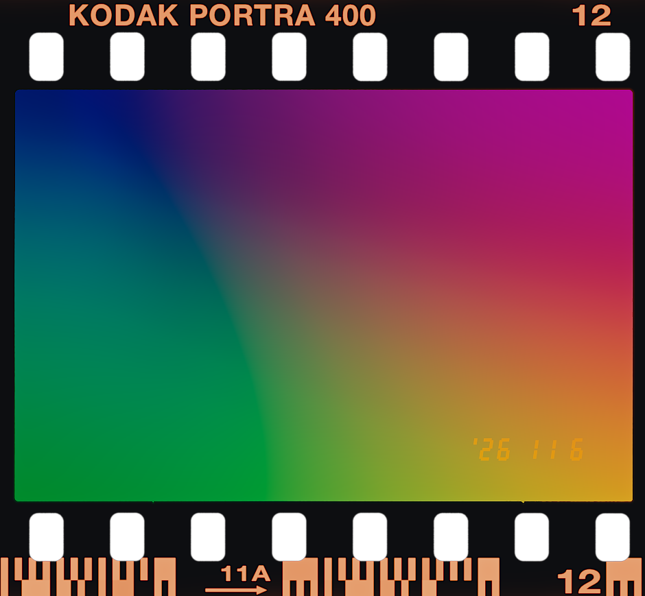

# SpektraFilmLab PS

**把胶片显影工作台带进 Photoshop：打开 RAW，调好胶片效果，再以 16 位 ProPhoto RGB 送入 PS 精修。**

基于 [SpektraLab](https://github.com/JamesQiu2005/SpektraLab) 和 Andrea Volpato 的 [spektrafilm](https://github.com/andreavolpato/spektrafilm) 的非官方开源集成。胶片算法、光谱模型和胶片资源来自上游；本项目负责 Photoshop 插件、RAW 工作流、本机通信与安装打包。

[下载 macOS Apple 芯片安装包](https://github.com/jerryhubrit/spektrafilmlab-ps/releases/tag/v0.3.2) · [安装说明](docs/INSTALL.md) · [实现思路](docs/ARCHITECTURE.md) · [编译源码](docs/BUILD.md) · [上游与许可证](NOTICE.md)

## 安装后怎么用

1. 下载 Release 中的 `SpektraFilmLab-PS-v0.3.2-macOS-arm64.zip` 并解压。
2. 双击 `安装.command`。安装器会复制引擎和胶片资源、生成这台电脑专用的连接配置、安装 PS 插件并启动引擎。**不需要 Python、Node、Xcode 或另行下载上游源码。**
3. 打开 Photoshop → **增效工具 → SpektraFilmLab PS → SpektraFilmLab RAW 显影工作台**。
4. 点击「打开 RAW…」，在大预览中调整。完成后点击「显影并送入 Photoshop」。
5. 重启电脑后先双击 `启动引擎.command`；用完可双击 `停止引擎.command`。

这是公开测试包，采用本地 ad-hoc 签名，**没有 Apple Developer ID 公证**。macOS 可能要求你在“隐私与安全性”中明确允许运行；安装器不会关闭 Gatekeeper 或批量清除隔离属性。具体步骤和排错见[安装说明](docs/INSTALL.md)。

### 运行环境

| 项目 | 当前范围 |
|---|---|
| 芯片 | Apple Silicon（M 系列）；不提供 Intel 或 Windows 二进制 |
| 系统 | 编译目标 macOS 15.0 起；实机验证 macOS 26.6.2 |
| Photoshop | 25.0 起；实机验证 27.11.0 |
| Adobe 依赖 | 已安装 Creative Cloud 桌面程序及其 UXP 插件安装器 |
| RAW | 以当前 macOS 的 Apple RAW 解码器支持机型为准 |
| 图像 | 输入最多 5000 万像素；PS 入口支持 RGB 8/16 位 |

## 能做什么

- **直接打开 RAW**：拍摄时白平衡／自定义色温与色调、支持时启用镜头校正。
- **胶片显影**：测光、胶片曝光、胶片与相纸、画幅、颗粒、光晕、散射、染料耦合、眩光和冲印滤色。
- **场景宽容度**：使用原生引擎的测量与拟合，支持自动适配和高光／阴影收回。
- **片边**：135、半格、120 与宽幅；齿孔、片窗、胶片边码、帧号、片夹、雾光、漏光和构图位置。
- **日期后背**：拍摄日期或手动日期、LCD／点阵／拍摄参数、位置、大小、亮度；日期作为光曝光参与胶片显影。
- **送回 PS**：全尺寸 16 位 ProPhoto RGB 新文档。也可读取当前 PS 可见合成图；无片边时输出新图层，有片边时创建包含整个胶片画布的新文档。

*上图是程序生成的合成色卡，不是客户照片。*

开启片边会按所选画幅裁切，用“构图左右／上下”调整位置；预览与输出使用相同构图。宽幅不支持日期后背；120 日期和拍摄参数需要片边。竖拍的日期随相机方向旋转。这些行为沿用原项目的胶片后背模型。

## 为什么做成 PS 插件

摄影师通常希望先确定胶片的曝光、色彩、颗粒和片边，再用 PS 做修肤、局部调整和合成。把一套完整的后期软件塞进 PS 并不是必要前提：我们保留上游胶片显影的核心，再补上直接 RAW 输入和高位深交接，形成 **RAW → 胶片显影 → Photoshop 精修** 的工作流。

UXP 面板负责交互与 PS 图像读写；Swift 辅助程序在本机调用 Apple RAW 解码和 SpektraLab 的 C++/Metal 引擎。预览缩小、同源缓存和最新参数优先调度用于控制交互延迟；完整分辨率只在送入 PS 时计算。具体实现、踩过的问题与限制见 [docs/ARCHITECTURE.md](docs/ARCHITECTURE.md)。

## 验证与限制

**v0.3.2：RAW 处理边界加固。** 保留 Apple Core Image → Float32 线性 ProPhoto → 胶片引擎的流程；新增 PS 写入前的位深、色彩空间、传递函数与行方向校验。上游固定版本已经使用内存传输，TIFF 是其旧的中转方式。逐像素验证和适用范围见 [RAW 处理说明](docs/RAW-PIPELINE.md) 与 [验证记录](docs/RAW-VALIDATION.md)。

开发机上，一张约 3274 万像素的 RAW：一次白平衡预览约 0.30 秒；完整显影并写入 PS 约 2.3 秒；加片边及日期后约 4.0 秒。这些是单次本机观测，不是所有机器和参数的性能保证。

- 22 项 JS 状态／日期／构图／模态回归；原生合成 RGB、透明度、缓存一致性、片边与日期测试；实际 PS RAW 到 16 位文档交接。发布包另做安装准备、独立令牌、权限、动态库和 Metal 渲染检查。
- 本版没有批量处理、双图半格拼接、自由旋转裁切、暗角、完整宽容度图表或可回改 RAW 的智能滤镜。
- 预览不是 1:1 颗粒校样；检查完整分辨率输出再决定最终效果。
- PS 入口不读取拍摄 EXIF，日期可手动指定；透明 PS 图像需要先添加不透明背景才能使用片边。
- macOS 15 和其他 PS 版本尚未逐一实机验证。
- v0.3.2 的两张公开 NEF/CR2 验证不能代表所有 RAW。此轮没有重新完成客户 ARW 或 Photoshop 实机 UI 验收；升级需同时更新面板和引擎，旧引擎会被新版面板拒绝。

## 隐私、源码与许可

照片只在本机处理。辅助程序仅监听 `127.0.0.1`，需要随机生成的本机令牌；没有云端渲染、分析或照片上传。印日期所需的少量 EXIF 字段只在本机流转。仓库、发布包和测试图片均不含客户照片、客户路径或个人连接令牌。

**分享原始 Release ZIP，不要分享安装后生成的 CCX 或配置文件。** 每次首次安装都会生成独立令牌，安装后的个人文件位于 `~/Library/Application Support/SpektraFilmLab PS/`。

- 插件、桥接程序及随附引擎软件：GNU GPL v3，见 [LICENSE](LICENSE)。
- spektrafilm 胶片 profiles／LUT／直接编码资源：Andrea Volpato，CC BY-SA 4.0，见 [原始资源许可](licenses/SPEKTRAFILM_LICENSE.txt)。
- SpektraLab 的确切上游版本、修改范围和第三方依赖见 [NOTICE.md](NOTICE.md) 与 [upstream.json](upstream.json)。
- 仓库包含重建所需的插件、安装器、辅助程序、上游引擎源码和胶片资源；不要求从已安装程序中反向提取代码。

维护者：[jerryhubrit](https://github.com/jerryhubrit)。本项目不代表 Adobe、SpektraLab 或各胶片品牌的官方产品。

## 联系方式

- 小红书：634627958
- WeChat：124209300
