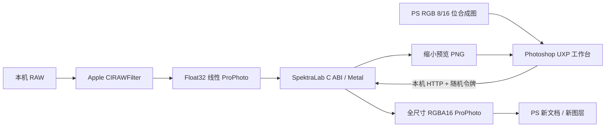

# 从 SpektraLab 到 Photoshop：思路与实现

## 要解决的问题

需要的是在 PS 精修之前完成胶片显影，同时能直接打开 RAW，保留色温、高光和高位深工作空间。已有胶片光谱模型值得复用；重新写一套近似滤镜会失去上游模型的意义。

最初的 RGB 读取插件证明了引擎能连接 PS，但只有小面板和少量滤镜控制，RAW 已经经过前置转换。之后我们改成大预览工作台，提供直接 RAW 解码，再迁移片边与日期后背。

## 架构

UXP 不直接加载这套原生动态库，所以采用本机辅助程序边界。网络和 GPU 运算发生在 Photoshop 的模态操作之外；PS 图像读取、创建及写入发生在 `executeAsModal` 内。辅助程序只绑定 loopback，并验证每台机器自己的 bearer token。

## 哪些来自上游，哪些是本项目新增

| 部分 | 来源与本项目职责 |
|---|---|
| 胶片模型、光谱计算、颗粒、光晕、相纸、片边、日期曝光 | SpektraLab 原生 C++/Metal 引擎，算法保持原样 |
| 胶片测量 profiles 和 LUT／常量资源 | Andrea Volpato 的 spektrafilm，沿用独立 CC BY-SA 4.0 许可 |
| RAW 两条解码路径、线性 ProPhoto、恢复原始白平衡的约定 | 参考 SpektraLab `ImageDecoder.swift`，适配为本机 helper |
| 边码、胶片画幅、日期格式及拍摄参数摘取 | 参考 `FilmEdge.swift` / `Session+FilmEdge.swift` |
| Photoshop 大窗口、参数绑定、源图状态检查 | 新增 UXP HTML/CSS/JavaScript |
| HTTP 协议、缓冲区转换、PS 高位深交接 | 新增 Swift bridge 与 UXP imaging 调用 |
| 打包与安装 | 新增 Swift 安装器；生成随机本机令牌和个人 CCX，使用 Adobe UPIA 安装 |

## RAW 为什么保留线性数据

对同一 RAW 保留两条 Apple 解码路径：关闭 Apple 色调呈现的线性图给胶片引擎；Apple 默认显示效果用于原图对照。两条路径使用相同的白平衡和镜头校正。引擎输入是 float32 线性 ProPhoto，避免在胶片显影之前压成 8/16 位显示图片。

色温／色调改变的是 RAW 解码器。恢复“拍摄时设置”时重建原始滤镜；把读出的色温数值重新赋回去，会触发自定义白平衡，并不等于完全恢复相机原始变换。

v0.3.2 增加了交接格式校验与原生像素验证，具体见 [RAW-PIPELINE.md](RAW-PIPELINE.md)。上游固定版本已由 TIFF 中转改成内存帧；是否保留正确的解码设置、线性浮点数、色彩空间和伽马约定，比是否写入 TIFF 更关键。

## 交互速度如何处理

- 预览源最长边 1024；只有输出时计算全尺寸。
- 单请求运行，保留最新参数，丢弃过时预览结果；滑杆有短暂防抖。
- 色温／镜头几何变化才更新 RAW 解码预览；只改胶片参数时复用解码结果。
- 只发送实际变化的引擎参数，减少无谓失效。
- 完整输出后释放完整尺寸引擎会话。

这里没有把“每个滑杆都实时全尺寸重算”当成目标，也没有修改上游光谱 profiles 来制造更快的近似结果。

## 与 Photoshop 连接时修复的问题

1. UXP imaging 的一些操作要求模态作用域；图像读写放入 `executeAsModal`，网络渲染放在外面。
2. 读取 PS 图像时不强制跨位深转换；读取原生 8/16 位，再转换为传输缓冲区。写入时使用全范围 UInt16。
3. 读取后保留文档 ID、历史状态和尺寸，防止用户换图或编辑后误写旧结果。
4. 片边会扩大画布。输出尺寸必须读取引擎实际结果和行步长，不能假设仍等于原图。带片边时新建文档，避免截掉齿孔或改变原文档画布。
5. 片边画幅在进入引擎前裁切，RAW 和 PS 入口按同一比例规则处理；预览与全尺寸共用参数、帧号及随机种子。
6. 日期后背不是最后盖上文字：日期作为曝光进入底片，继续参与上游的显影、光晕和颗粒计算。

## 安装与安全边界

公共 ZIP 无令牌；安装器在用户自己的 Application Support 目录生成配置，再将它装进本机 CCX。目录权限为 0700，配置和生成的 CCX 为 0600。引擎没有公开网络监听或云端接口。

HTTP 接口可以读取用户通过面板选择的本机 RAW 路径，因此令牌不能公开。它是同一用户本机组件间的访问隔离，不是抵御已取得该用户账户权限的安全边界。安装器只停止自己记录且验证身份的进程；端口被其他程序占用时提示，不强杀。

## 当前取舍

先支持经过实际验证的 Apple Silicon + Metal 路径。Windows／Intel、双图半格拼接、智能滤镜和完整批量工作流仍需独立实现。macOS 15 是编译下限，不能代替在每个系统和 PS 版本上实际测试。
